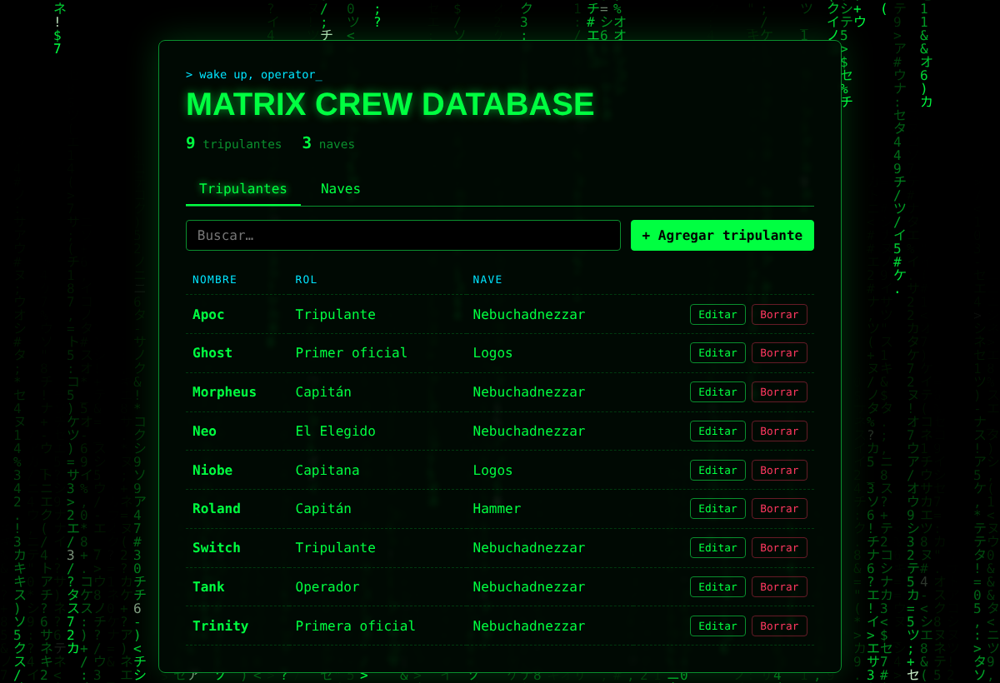

# Matrix Crew Database

A fun, Matrix-themed CRUD app to manage the crews of the ships in Zion's fleet:
**Django REST Framework** API on the back-end and **React** on the front-end. First built in 2022, rebuilt in 2026.



## Features

- Crew members (name, role, ship) and ships, with create / edit / delete and search
- Ships show how many crew members they have; deleting a ship keeps its crew (unassigned)
- Browsable REST API and Django admin
- Animated digital-rain background drawn on a canvas

## Tech

| Back-end | Front-end |
| --- | --- |
| Python 3.12+, Django 5.2 LTS, Django REST Framework, django-cors-headers, SQLite | React 19, Vite, plain CSS |

## Run it locally

**1. API** (http://localhost:8000/api/)

```bash
cd backend
python -m venv .venv
source .venv/bin/activate      # Windows: .venv\Scripts\activate
pip install -r requirements.txt
python manage.py migrate
python manage.py seed          # optional: sample ships and crew
python manage.py test
python manage.py runserver
```

Settings come from environment variables (see `backend/.env.example`):
`DJANGO_SECRET_KEY`, `DJANGO_DEBUG`, `DJANGO_ALLOWED_HOSTS`, `CORS_ALLOWED_ORIGINS`.

**2. Front-end** (http://localhost:5173)

```bash
cd frontend
npm install
npm run dev                    # set VITE_API_URL if the API is not on localhost:8000/api
```

## API

| Route | Methods |
| --- | --- |
| `/api/naves/` | `GET`, `POST` |
| `/api/naves/{id}/` | `GET`, `PUT`, `PATCH`, `DELETE` |
| `/api/tripulantes/` | `GET`, `POST` |
| `/api/tripulantes/{id}/` | `GET`, `PUT`, `PATCH`, `DELETE` |

## What changed in the 2026 rebuild

- Removed the committed Python virtualenv (~7,600 files), `__pycache__` and the SQLite database
- Django 4.1 → 5.2 LTS; secret key and debug flag moved to environment variables; CORS limited to the front-end origin
- Hand-written function views → DRF `ModelViewSet` + router, with proper status codes and validation
- Fixed: ids with two or more digits could not be edited or deleted (URL regex `([0-9])`)
- A crew member's ship is now a real foreign key instead of free text
- Front-end: CRA + React Bootstrap + react-reveal → Vite + React 19; fixed an infinite refetch loop
  (`componentDidUpdate` fetched on every render); native `<dialog>` forms; canvas rain instead of an 8 MB GIF
- Tests for the API

The original version is preserved in the git history.
